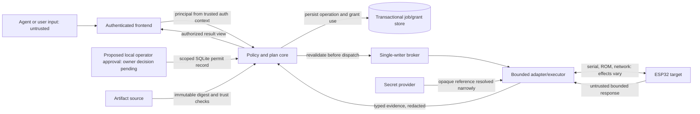

# DeviceOps — threat model and security scenarios

**Status:** accepted trust-model baseline for [D03 / #70](https://github.com/ozand/adv/issues/70), not a security audit or proof of implemented controls. **Epic:** [#66](https://github.com/ozand/adv/issues/66). Decision: [ADR-018](../adr/ADR-018-deviceops-authority-grants-threat-model.md). This document authorizes no equipment, network, credential, or deployment operation.

## 1. Scope and evidence boundary

This threat model covers the proposed host-side DeviceOps policy and executor boundary: authenticated callers, frontends, queued operations, grants, target/session binding, artifacts, transports, receipts, secrets, and the physical device effects invoked by adapters. It does not establish that DeviceOps exists, that any control is implemented, or that a hardware identity mechanism is available.

Inputs and assumptions are drawn from open Issue #70, the exact proposed security/contract docs in PR #82 candidate `196d2f915e0fa2424b707f3fd30d873050a3b022`, accepted ADR-006/009 in that candidate, and accepted ADR-015/016/017. ADR-014 remains Proposed for the broader service/API direction. D01 choices (Python/Windows first, one persistent executor over authenticated local-user named pipes, SQLite local storage, and private runtime repo/path) are accepted; D02 schemas and D03 grant issuer/lifecycle remain proposals or owner decisions. Packaging, ACL, durability, trusted-clock, and cross-process qualification remain open. All controls below are requirements or hypotheses to validate, not present guarantees.

## 2. Security objectives and assets

Protect:

- **Target integrity:** prevent an authorized operation for one board/session from reaching another or an ambiguous re-enumerated target.
- **Operation integrity:** bind approved normalized arguments, immutable plan, adapter/policy revision, and exact artifact to the eventual dispatch.
- **Authority integrity:** only a trusted issuer/policy path grants scoped authority; the requesting model cannot approve itself.
- **Effect safety and honest outcomes:** bound resets, storage writes, audio/RF output, external network actions, and preserve partial/unknown outcomes without blind replay.
- **Confidentiality:** keep credentials, user data, raw logs/audio/dumps, and sensitive low-entropy hashes out of model-visible output, errors, public fixtures, and public repository content.
- **Availability and exclusivity:** prevent unbounded requests, queue exhaustion, stale workers, and concurrent writers from causing uncontrolled hardware operations.
- **Evidence provenance:** distinguish request, transport transmission, device acknowledgement, verification, and physical observation; prevent untrusted device text from becoming executable instructions or authority.

## 3. Actors and trust assumptions

| Actor / component | Assumed trust | Security boundary / failure mode |
|---|---|---|
| Local interactive Windows user / accepted grant issuer | Authority derives from the authenticated named-pipe OS principal; this proves process identity, not human presence. An agent running as that same user may invoke the issuer surface; this bounded local-user authority is owner-accepted for MVP | Mistaken scope, wrong target selection, same-user code exercising issuer authority, or compromised account |
| Agent/model and its supplied arguments | Untrusted | Prompt injection, self-approval, confused deputy, malicious plan/artifact references |
| CLI/MCP/web frontend | Authenticated principal context required; client payload itself untrusted | Principal spoofing, frontend-specific policy bypass, cross-user access |
| DeviceOps core/policy | Intended enforcement point, not yet implemented | Bug, stale policy, confused deputy, TOCTOU, inconsistent transport rules |
| Job store / queue / clock | Must provide specified atomicity and time semantics | Crash, rollback, duplicate delivery, stale state, clock rollback, disk-full |
| Executor / broker / adapter | Trusted bounded component with exclusive ownership | Stale worker, second writer, unsafe reset on open, argument injection, transport loss |
| Artifact/build pipeline | Artifact bytes and metadata are untrusted until policy validates provenance | Substitution, traversal, symlink/TOCTOU, malformed image, compromised build |
| Device firmware / logs / network responses | Data, not authority | Malformed/oversized replies, stale marker, injected text, false claims |
| OS administrator / independent USB process | Out of scope for service-only protection unless separately constrained | Can bypass local policy, read files/secrets, open the port, or race/alter execution |
| Physical attacker / modified device | Not proven prevented by software grants | Physical substitution, firmware modification, electrical effects, untrusted peripherals |

**Out of scope for the proposed host policy alone:** guaranteeing protection against a fully privileged OS administrator, equally privileged process able to modify the local store, independent process with direct USB/serial access, physical board substitution, compromised trusted issuer, or compromised host kernel. The accepted D01 boundary is a local Windows executor with named pipes and SQLite; its ACL, tamper resistance and bypass behavior still require qualification. These risks cannot be erased by the service alone.

## 4. Trust boundaries and flows

The frontend cannot be the only enforcement point if another interface can dispatch directly. A status-like API is not necessarily effect-free: opening a serial transport may toggle reset/control lines. The target and operation must be bound before opening such a transport. Firmware output, Skills text, annotations, and audit records never feed grant issuance.

## 5. Threat scenarios and required controls

| ID | Threat / abuse case | Required prevention or detection | Required evidence / test | Residual risk |
|---|---|---|---|---|
| TM-01 | Model submits `approved=true`, fake tool annotation, or log text claiming operator consent | Ignore client approval claims; authorize only trusted issuer/policy record bound to principal and operation | Inject approval-like JSON/log/tool metadata; assert deny and zero fake transport calls | Compromised issuer or policy implementation |
| TM-02 | Confused deputy: one principal uses another user's grant or target | Derive principal from authenticated context; include principal in grant and idempotency scope; enforce per-target ownership | Wrong-principal grant and cross-user request fixtures | Auth provider compromise; OS administrator |
| TM-03 | Grant replay, concurrent double-consumption, or budget race | Finite use/effect budget; atomic consume with accepted operation; unique use/idempotency record | Concurrent fake-clock/store race; exactly one permitted dispatch | Store/transaction implementation failure; device-side exactly-once is not promised |
| TM-04 | Grant revoked while operation waits in queue | Recheck revocation, expiry, policy revision, principal, target, plan and artifact immediately before dispatch | Enqueue, revoke or mutate binding, drain queue; assert no I/O | Revocation after physical I/O begins cannot undo effects |
| TM-05 | Neighbor board or re-enumerated device receives authorized action | Bind explicit target evidence/session generation and minimum identity strength; ambiguous rebinding fails closed | Swap fake device identity and simulate disconnect/reconnect ambiguity | VID/PID and OS locator are not cryptographic identity; physical substitution remains |
| TM-06 | Plan/artifact/arguments change between approval and execution | Immutable canonical plan; digest binding; rehash exact bytes; defend path traversal and TOCTOU; allowlisted backend argv without shell | Replace file/plan/adapter after grant; assert reject before dispatch | Compromised host or artifact issuer |
| TM-07 | Replayed or stale firmware marker/response is treated as capability or identity | Marker is informational; bind response to session/operation; enforce schema, size and freshness; do not infer hardware PASS | Stale-frame, wrong-session, malformed/oversize and marker-only fixtures | Firmware may lie or be compromised |
| TM-08 | Device log, SSID, manifest, or serial text injects instructions into model | Parse bounded typed fields; preserve untrusted text as data; redact and isolate; no policy decisions from content | Prompt-injection payload fixtures in every ingress/result surface | Model may still misinterpret safe presentation; frontend must label provenance |
| TM-09 | Secret reference is broadened, leaked, or resolved into logs/errors | Narrow opaque references; authorize purpose/target; resolve only in trusted component; redact stdout, exceptions, receipts and model responses | Synthetic secret-canary scan across positive and failure paths | Memory/process inspection by privileged host; unknown third-party libraries |
| TM-10 | Revocation/timeout falsely claims a flash or write was cancelled | Model transmission, acknowledgement, effect certainty and verification separately; operation-specific safe point/quarantine; no automatic retry | Revoke during partial write/lost ACK; assert inconclusive/partial and zero retry | Physical outcome may remain unknown until separate reconciliation |
| TM-11 | Stale worker continues I/O after lease expiry while a second writer starts | Lease expiry is not proof of stop; fence generations; hold exclusive ownership until confirmed stop or quarantine | Fake worker continues after expiry; assert second writer blocked | Host cannot fence external process that bypasses broker without OS support |
| TM-12 | Frontend or browser route bypasses common policy | All effectful paths call the same core/broker; transport identity never upgrades scope | CLI/MCP/fake-browser equivalence and direct-backend denial tests | Uncontrolled alternate binaries/USB processes remain outside service boundary |
| TM-13 | Malformed or excessive requests exhaust queue, parser, memory or logs | Finite schema/message/queue/retention limits; bounded parsing; backpressure; quotas per principal | Boundary/overflow, slow-reader, disk-full, malformed-frame fixtures | Resource limits can still cause denial of service within configured budgets |
| TM-14 | Identity/clock/store rollback makes expired or consumed grant usable | Trusted monotonic/UTC policy and durable versioned consume state; fail closed on unavailable/corrupt state | Clock rollback, DB restore, crash at consume/dispatch boundaries | Exact guarantee depends on D01 storage/OS choice |
| TM-15 | Untrusted PR/build job reaches USB or production credentials | Separate build sandbox and hardware executor; no secret/USB capability in untrusted CI; artifact review gate | Fake CI capability test and access inventory | Compromised trusted release pipeline |
| TM-16 | Audio/RF/storage/reset effects are hidden under generic “read” grant | Explicit effect taxonomy and operation-specific scopes/budgets; cached read distinct from fresh I/O/reset/storage/audio/RF/network/disclosure | Effect-class contract tests; assert wrong effect denied | Actual device/library effects may be incompletely documented |

## 6. Proposed grant and dispatch invariants

Accepted MVP issuer: an operator-authorized action uses a local approval surface that is not exposed as a DeviceOps tool. The executor derives the issuer principal from the authenticated Windows named-pipe client context; it rejects caller-supplied principal strings as authority. This authenticates the client process/user, not human presence: a process running as the same user may invoke the issuer surface. Tool calls, device output, annotations and logs cannot issue or broaden grants by themselves. The scoped permit is kept in the local SQLite store and only an opaque reference may appear in model-visible results.

A grant or equivalent trusted authorization record should bind at minimum:

1. issuer identity and authenticated principal;
2. target reference, binding/session evidence, and minimum accepted identity strength;
3. named operation, schema/policy version, and canonical normalized arguments **or** immutable plan digest;
4. artifact digest and trust decision when bytes are installed or executed;
5. permitted effects and explicit exclusions;
6. issuance/expiry, finite use or effect budget, and revocation state;
7. policy revision and any material preconditions that must be revalidated.

Before dispatch, the core should atomically verify and consume authority against the operation record, then the broker should verify the same target/session and plan remain current. If persistence/clock/identity/revocation state cannot be established, deny before I/O. A changed field requires a new grant, not silent mutation. The proposed local MVP uses a SQLite permit row, not a signed bearer token. A single transaction records grant-use reservation and accepted operation/dispatch intent before I/O; after an uncertain crash the reservation remains consumed and the operation is inconclusive, never automatically replayed. The owner accepted this issuer and lifecycle baseline; documentation acceptance does not mean runtime enforcement is complete.

## 7. Effect and uncertainty model

Each capability declares separate effects: cached-read; fresh transport I/O; open/reset/control-line change; volatile state; persistent storage; physical audio/RF output; external network action; and sensitive-data disclosure. Permission for one class does not imply another. A host timeout is not evidence that device execution stopped. Receipts separately record dispatch/transmission, acknowledgement, effect certainty, verification, and any physical observation; `unknown` is a valid terminal fact, not a reason to retry.

Revocation has two temporal semantics:

- **Before dispatch:** no new external I/O may begin; queued work is denied.
- **After dispatch begins:** apply the documented operation-specific safe point or isolate/quarantine the executor. Do not assert no effect, cancellation, rollback, or successful recovery without evidence.

## 8. Security validation plan (fake-only)

No physical transport is needed for these checks. The fake adapter must fail the test if invoked by any denied case. Required negative scenarios include:

- absent, expired, revoked, wrong-principal, wrong-target, wrong-plan, wrong-artifact, stale-policy and insufficient-effect grants;
- duplicate/replayed use and concurrent budget exhaustion;
- revoke-after-enqueue and target/artifact replacement before dispatch;
- fake `approved=true`, tool metadata, firmware marker, log/SSID prompt injection and secret canary;
- ambiguous reconnect, wrong session generation, stale result and malformed/oversized device response;
- lost ACK/partial write followed by attempted retry; revocation during in-flight fake write;
- stale worker after lease expiry, direct alternate transport path and untrusted build attempting USB/secret access;
- disk full, corrupted/rolled-back store, clock rollback, queue overflow and cancellation at each stage.

For each case record exact source SHA, fixture/test name, fake transport call count, expected/actual authorization result, and remaining uncertainty. These are proposed tests; none is claimed implemented or passing here. D02/#69 may refine schema and lifecycle vocabulary; changes must preserve the security properties rather than silently weaken them.

## 9. Open decisions and dependency gates

- **D01/#68 accepted:** Python/Windows 11 x64 first, SQLite local durable storage, one persistent executor with authenticated local-user Windows named pipes, and private `ozand/deviceops` path boundary. Packaging, ACL qualification, trusted clock details and durability guarantees remain untested.
- **D02/#69:** canonical schemas for principal, identity evidence, capability/effects, plan, grant reference, operation lifecycle and reason codes remain proposals.
- **D03/#70 accepted:** bounded local-user issuer and scoped SQLite permit record with transaction/reserve/revalidate/crash-as-consumed lifecycle, as recorded in ADR-018 and owner receipt [comment 6134302252](https://github.com/ozand/adv/issues/70#issuecomment-6134302252). Same-user agents may exercise that user's authority; this is not human-presence proof. Implementation and ACL/durability qualification are incomplete; no hardware authority follows.
- **Later deployment/remote work:** authentication provider, cross-user boundary, secret provider, network exposure, rate limits, incident response and independently reviewed deployment profile.

The owner accepted the D03 issuer/lifecycle baseline. Enforcement implementation proceeds in staged fake/offline slices under Issue #70 and the private runtime repository; D02 schemas remain separately governed. Hardware access, network exposure, system-service installation, and production security qualification remain excluded pending their own gates. This draft does not imply that a documented SQLite record is authentic against a same-user/administrator attacker.

## References

- [Issue #70](https://github.com/ozand/adv/issues/70) and [Epic #66](https://github.com/ozand/adv/issues/66)
- [D01/#68](https://github.com/ozand/adv/issues/68), [D02/#69](https://github.com/ozand/adv/issues/69)
- [PR #82 candidate, exact SHA `196d2f915e0fa2424b707f3fd30d873050a3b022`](https://github.com/ozand/adv/pull/82)
- [DeviceOps SECURITY](SECURITY.md), [CONTRACTS](CONTRACTS.md), [ARCHITECTURE](ARCHITECTURE.md), [VALIDATION](VALIDATION.md)
- [ADR-006](../adr/ADR-006-hardware-diagnostic-serial-json.md), [ADR-009](../adr/ADR-009-bounded-opt-in-audio-diagnostics.md), [ADR-014](../adr/ADR-014-deviceops-service-centered-agent-infrastructure.md), [proposed ADR-018](../adr/ADR-018-deviceops-authority-grants-threat-model.md)
